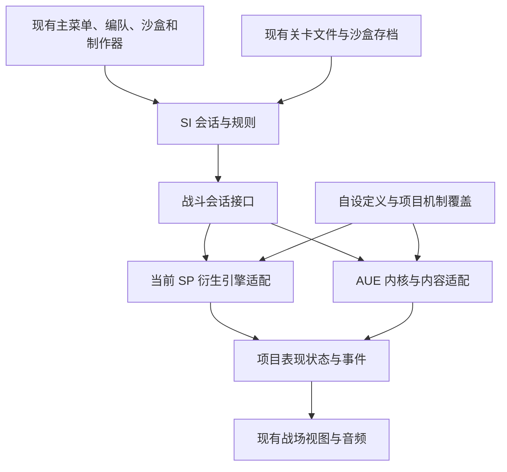

# AUE 引擎迁移评估

日期：2026-10-28。对象：[ArknightsDevs/Arknights-Universal-Engine](https://github.com/ArknightsDevs/Arknights-Universal-Engine)。源码基线固定为标签 **v0.1.4** 对应的提交 [`b25523619c981cb1380928ffe96b0fcd67263e74`](https://github.com/ArknightsDevs/Arknights-Universal-Engine/tree/b25523619c981cb1380928ffe96b0fcd67263e74)，提交时间为 2026-10-28 10:55:07（UTC+8）。该快照的根 README 仍称 v0.1.3，版本判断以标签和提交为准。

对照的是本项目当前工作区，包括现行关卡命名与保存逻辑。本评估依据源文件、包依赖、数据索引和架构决策进行静态分析，没有安装或运行 AUE，没有进行战斗、性能或兼容性测试。

## 1. 结论

2026-10-29 的全量源码／数据／导入审查与当前试接顺序见[试接方案](引擎迁移试接方案.md)。该轮选择先保留本地 kit 和 SI 规则，隔离接入 AUE，再逐项评估是否转用原生；并未证明全量原生行为等价。

**值得借鉴 AUE 的边界设计，也值得开展隔离的接入原型；目前不应直接替换正式引擎，更不应把三大模块整体搬到一个新的 AUE 应用里重做。** 推荐保留本项目的页面、关卡文件、沙盒存档和内容定义，在产品层与引擎之间建立适配层，再决定是否切换战斗内核。

这不是近乎无痛的升级。两边虽使用 JavaScript、30 帧模拟和部分同源 kit，但战斗对象、数据模型、部署入口、表现事件、渲染器与依赖安装方式都不同。至少存在 13 人编队、自由沙盒重复部署、自设结城理多技力系统和自定义特效事件四类明确障碍。

**沙盒、关卡游玩、关卡制作器和三名自设干员都具备保留路径，但“能保留”需要对应的适配工作，不能理解成换包后原样生效。** 制作器和局外界面与引擎的距离较远，保留成本相对低；自由沙盒、自设机制和局内表现的成本最高。迁移是否完成，应以现有功能和规则均得到保留来判断，不能以干员数量变多或一张地图能开局替代。

## 2. AUE 已经提供什么

### 2.1 内容数量与机制覆盖须分开

该快照的 `packages/content/data/operators/index.json` 实际登记 **461 名干员**，目录另有一份索引文件，不能把目录里的 462 个 JSON 算成 462 名干员。`kits.json` 启用 **72 个 SP kit**，来源固定为 Stronghold-Protocol `v0.3.1` 的提交 `b3deebdae4a92642c007d217a1a4573e5d3612c5`。其余干员依赖 AUE 原生的数据解释和通用机制。[干员索引](https://github.com/ArknightsDevs/Arknights-Universal-Engine/blob/b25523619c981cb1380928ffe96b0fcd67263e74/packages/content/data/operators/index.json)、[kit 登记](https://github.com/ArknightsDevs/Arknights-Universal-Engine/blob/b25523619c981cb1380928ffe96b0fcd67263e74/packages/content/data/kits.json)

这扩大了本项目现有 202 名原作可选干员之外的接入基础，但没有证明每个新干员的全部天赋、技能和特殊操作均已还原。上游明确保留部分特殊机制、技能效果、敌人能力和画面同步的未完成项；不能把“全体可上场”作为机制全部完成的证据。[上游功能与进度说明](https://github.com/ArknightsDevs/Arknights-Universal-Engine/blob/b25523619c981cb1380928ffe96b0fcd67263e74/README.md#进度)

望、维什戴尔、凯尔希·思衡托在这 72 个 kit 的启用名单内；原作结城理、官设维娜不在该名单内。原作结城理的数据存在，也不能替代本项目自设结城理的技能与人格系统。这些都是内容身份不同的实现，迁移时必须保留独立 ID。

**望的归属要单独说清**：望是原作干员（`char_2027_wang`），本项目对她的 kit 与表现做过修正，但那属于对原作实现的修改，不是新增内容。若 AUE 的望在其自身口径下正确，正确做法是用 AUE 版替换本项目这份，并保留被替换的实现作为回退与逐项对照——而不是像三名自设那样必须自建。判断依据是作者实机试玩，不是"能不能跑"。自设只有三名：斗士塔露拉、维娜·维多利亚、结城理（`content/operators/index.json`）。

### 2.2 模块边界有实际价值

| 包 | 可用于本项目的能力 | 接入边界 |
|---|---|---|
| `@aue/math`、`@aue/schema` | 数值规则、版本化命令与状态格式 | 先随引擎接入，不宜单独替换当前战斗数学函数 |
| `@aue/sim` | 纯战斗状态、帧推进、命令处理和行为扩展 | 是主要候选；不要求本项目恢复联机服务 |
| `@aue/content` | 原作记录、技能行为、SP kit 兼容层 | 需合并本项目内容覆盖与自设行为，不能整包覆盖现有定义 |
| `@aue/render`、`@aue/spine` | three.js 战场与独立 Spine 运行时 | 属于另一项表现迁移，不应与内核第一次接入同时切换 |
| `@aue/ui` | 上游界面系统 | 当前三大模块无需重写为该系统 |
| `@aue/net`、`@aue/worker` | 帧同步与后台会话 | 当前 worker 会话包含连接与重连逻辑，不能把它直接当成本项目的本地 runner |
| `@aue/data`、`@aue/sdk` | 官方数据整理与数据 mod 工具 | 可借鉴数据契约；不等于本项目获得自设干员制作流水线 |

`sim` 不得导入渲染、UI 或网络，渲染只能消费模拟输出；兼容代码被限制在内容层。这些边界既有架构规定，也有包级结构支撑，比按角色持续往产品控制器里补分支更适合长期维护。[模块边界 ADR](https://github.com/ArknightsDevs/Arknights-Universal-Engine/blob/b25523619c981cb1380928ffe96b0fcd67263e74/docs/adr/0008-module-boundaries.md)、[字段归属 ADR](https://github.com/ArknightsDevs/Arknights-Universal-Engine/blob/b25523619c981cb1380928ffe96b0fcd67263e74/docs/adr/0045-unit-field-ownership-compat-isolation.md)

模块化更明确，不等于整个底座更轻。该快照内核和内容还包含合作、堡垒守御、阵地足球等本项目暂不需要的规则。应评价需要接入的包、接口和模式能否隔离，不能只凭根目录整齐就判断迁移后复杂度一定下降。

### 2.3 当前能力仍有边界

数据 mod 可以修改记录并增加干员、关卡，但当前不能新增敌人、召唤物或攻击范围，也不能携带自有图片、模型和声音。新增干员的公开数据接口使用 `look` 借用官方外观。ADR 中关于 mod 素材的目标不能代替当前实现。[实际 mod 限制](https://github.com/ArknightsDevs/Arknights-Universal-Engine/blob/b25523619c981cb1380928ffe96b0fcd67263e74/docs/mods.md#限制)

这不代表在自有应用里不能加载自设素材或定义新的内容行为；它意味着本项目不能把现有 `content/` 打成几个数据 mod，就完成全部接入。塔露拉的敌人模型借用、自制特效，结城理的独立投影和自制敌人，都需要应用自己的内容及素材适配。

## 3. 为什么不能直接换目录

### 3.1 战斗入口和对象不同

本项目的旧引擎建场、结束规则、部署、手牌及存档恢复现已集中到 `public/sandbox/js/session.js`；`battle-session.js` 调用门面。门面仍返回旧单位形状，尚未完成新旧数据投影。`battle-runner.js` 调用对象的 `start/step/snapshot/drainEvents`。这里既有稳定入口，也有产品层对引擎内部方法的依赖。

AUE 的核心入口则是 `createWorld(content, {seed, players})` 和 `step`，世界、内容与命令分开。它没有一份可以直接替换上述 Battle 实例的公共对象。必须把本项目的创建、推进、部署、技能、撤退、观察和结束操作转换到新的契约；继续在各 UI 文件中模拟同名私有方法，会把原有耦合带进新底座。[AUE 内核导出](https://github.com/ArknightsDevs/Arknights-Universal-Engine/blob/b25523619c981cb1380928ffe96b0fcd67263e74/packages/sim/src/index.js)、[世界创建与帧推进](https://github.com/ArknightsDevs/Arknights-Universal-Engine/blob/b25523619c981cb1380928ffe96b0fcd67263e74/packages/sim/src/world.js)

### 3.2 13 人编队与沙盒规则有明确冲突

AUE 的标准 match 校验写死 `MAX_DECK = 12`，并拒绝一副牌里重复的干员 ID。本项目编队上限是 13，自由沙盒还支持重复部署同一干员。直接接标准 match 会改变现有功能。[match 校验](https://github.com/ArknightsDevs/Arknights-Universal-Engine/blob/b25523619c981cb1380928ffe96b0fcd67263e74/packages/schema/src/match.js)

12 是标准 match 的限制，不应据此认定底层世界绝对容纳不了第 13 人。可研究 SI 自有内容构建入口、可配置上限，或向上游提出通用扩展；无论采取哪条路，都要覆盖手牌、召唤物归属、同模板多实例和计分身份。不能用绕过一条校验就宣称重复部署已经兼容。

自由沙盒的强制开技、自由调整现场、刷怪、关图后重建与不自动结束也不属于普通对局的同一组规则。需要独立的沙盒控制策略，不应伪装成标准玩家命令，更不能把这些自由权限带进游玩自制关卡。

### 3.3 事件和渲染数据不兼容

本项目 runner 输出对象快照和事件数组；`field-view.js` 还直接读取实际单位的 `mem`、技能状态和剩余攻击冷却，向望、维娜、结城理的专属表现模块投影状态。

AUE 的 `toView` 输出带版本的 `Float64Array`，单位按固定字段排列；表现事件使用 `{type, ...}` 对象。当前标准 View 包含位置、HP、SP、技能和异常状态等，但没有本项目的自设人格、望的跟子序列或全部专属表现字段。不能只把数组转成对象，就认为信息已经足够。[View 格式](https://github.com/ArknightsDevs/Arknights-Universal-Engine/blob/b25523619c981cb1380928ffe96b0fcd67263e74/packages/schema/src/view.js)、[表现事件格式](https://github.com/ArknightsDevs/Arknights-Universal-Engine/blob/b25523619c981cb1380928ffe96b0fcd67263e74/packages/schema/src/events.js)

尤其是兼容层中的 **`ShBattle.fx() {}` 当前为空函数**。本项目大量 `battle.fx('talula…')`、`vina…` 和望落子/爆炸的事件不能直接经过该入口保留。迁移必须增加项目表现事件桥和专属状态投影，保持模拟向画面单向流动；不能让特效模块反过来推动伤害或技能结算。[兼容 Battle 实现](https://github.com/ArknightsDevs/Arknights-Universal-Engine/blob/b25523619c981cb1380928ffe96b0fcd67263e74/packages/content/src/compat/battle.js)

### 3.4 同源 kit 不等于本项目修复自动继承

AUE 用固定 SP 提交的 kit，通过导入映射、单位包装和事件转换运行。加载失败的 kit 会被列入 `failed`，并使用原生实现；处理函数的异常会被记录并跳过。因此“没有崩溃”和“角色能部署”都不足以证明技能正常。[kit 加载器](https://github.com/ArknightsDevs/Arknights-Universal-Engine/blob/b25523619c981cb1380928ffe96b0fcd67263e74/packages/content/src/compat/kitmod.js)、[kit 安装与绑定](https://github.com/ArknightsDevs/Arknights-Universal-Engine/blob/b25523619c981cb1380928ffe96b0fcd67263e74/packages/content/src/compat/kits.js)

本项目对望、维什戴尔、召唤物手牌、手动部署、敌人增益及声音事件已有独立修改。AUE 的 72 个 kit 不是这些文件的最新副本，不能用它们直接覆盖当前文件。其中望这类**原作干员的修正**应当在 AUE 版可信时改用上游实现（先保留本地版作回退），这与三名自设必须自建是两条不同的路。

其已登记 37 项相对 SP 的行为差异，包含整数帧时长、伤害穿透顺序、同名 Buff 默认叠加规则及攻击前摇命中时机等。这些差异可能是有依据的改进，但也会改变相同阵容的伤害和表现。原作规则应逐项确认，自设规则应保持作者已经确定的语义。[差异登记表](https://github.com/ArknightsDevs/Arknights-Universal-Engine/blob/b25523619c981cb1380928ffe96b0fcd67263e74/docs/registry/known-differences.json)

例如当前 `field-view.js` 使用 `WIND_LEAD` 和实际攻击冷却提前起手，用于配合现引擎的命中时机。AUE 已有原生攻击前摇与攻击事件；保留旧画面时必须重做这段衔接，不能将两套提前量叠加。

## 4. 三大模块和现有特性的保留方式

| 现有部分 | 保留判断 | 迁移时需要处理的内容 | 相对工作量 |
|---|---|---|---|
| 主菜单、主题、导航、全局设置 | 可以保留当前页面 | 保留宿主页和产品状态，不接入上游活动大厅 | 低 |
| 局外 BGM 连续播放与 OGG 循环 | 可以保留现有播放器 | 仅对接战斗进出、结算淡出及局内音频设置，不整体更换声音系统 | 低至中 |
| 关卡库、导入导出、改名和保存 | 可以保留当前文件契约 | 继续用现有 API 与文件身份规则，不把 AUE 的 match 当关卡文件 | 低 |
| 关卡制作器、地形与时间轴编辑 | 可以保留现有交互 | 在开战边界转换地图、路线、等待、消失/出现、出生与敌人定义；编辑推演仍需与战斗解释一致 | 中 |
| 13 人编队、八套配置、技能/模组选择 | 可以保留界面和配置 | 建立 ID/练度/技能/模组映射，解决标准 match 的 12 人限制 | 中 |
| 自由沙盒 | 能保留，但不是现成模式 | 实现重复部署、多实例、刷怪、强制技能、自由重建及关闭普通终局 | 高 |
| 严格关卡战斗 | 能保留 | 对接费用、部署上限、生命上限、再部署、清场胜利、失败和退出 | 中至高 |
| 六槽沙盒存档与当前现场 | 可保留格式及用户数据 | 迁移 HP、SP、冷却、剩余路线、费用和计分的恢复；不直接塞入 AUE Snapshot | 中至高 |
| 火力计分板和结算报告 | 可保留布局与交互 | 从有效伤害的机制事件取得类型、来源和召唤物归属；标准 `hit` 表现事件不足以恢复现有分类 | 中 |
| 三名自设干员、专属特效与声音 | 能保留 | 内容适配、机制补口、专属状态投影、事件与素材解析分别迁移 | 高 |
| 官方模型、特效和缺图回退 | 资源可复用，加载代码不能直接复用 | 当前 URL 清单、动画映射与 AUE 渲染素材输入之间需转换 | 高，若切渲染器 |

这里的“低”不表示零改动；“高”也不表示必须重写整个模块。分类依据是当前源码跨越引擎边界的程度，不是未经实际接入得出的工期估计。

### 4.1 关卡文件保持为产品格式

现有 `shared/level.js`、`level-run.js` 和关卡库 API 应继续作为编辑、分享和保存的契约。转换发生在内存里的开战过程：地形符号变为 AUE Tile、路线和出生记录变为引擎内容，`meta.deployLimit/lifeLimit/theme/bgm` 分别进入部署规则、生命规则、主题内容和播放器。

AUE 使用可变宽高的 tile 地图，路线坐标也以行列表示，具备承接自制地图的基础；现有 JSON 仍不能直接当成它的内容结构。必须明确行方向、朝向、地形可部署性、路径时间和秒到帧的取整方式，不批量改写已有关卡文件。[AUE 地图结构](https://github.com/ArknightsDevs/Arknights-Universal-Engine/blob/b25523619c981cb1380928ffe96b0fcd67263e74/packages/sim/src/level.js)

### 4.2 沙盒存档不能当作 AUE 完整快照

本项目存档保存现场的选定状态，原本就不恢复进行中的技能、异常状态和弹道。迁移首先应保持这份现有承诺，而非擅自改成完整战斗恢复。

AUE 虽提供 `takeSnapshot/restoreSnapshot`，当前格式版本为 20，但兼容 kit 的钩子、定时器和包装状态不全在世界 JSON 中。上游 ADR 明确指出使用这些钩子的内容不能只靠快照恢复，需要重放。故不能依据“确定性 + Snapshot”宣称三名自设的运行状态已经能无损保存。[快照实现](https://github.com/ArknightsDevs/Arknights-Universal-Engine/blob/b25523619c981cb1380928ffe96b0fcd67263e74/packages/sim/src/snapshot.js)、[钩子与快照限制](https://github.com/ArknightsDevs/Arknights-Universal-Engine/blob/b25523619c981cb1380928ffe96b0fcd67263e74/docs/adr/0057-hook-bus-and-timers.md)

## 5. 自设干员的具体成本

### 塔露拉

当前 kit 依赖范围、阻挡与飞行处理、灼燃爆发、多个持续地块和移动焰浪，并产生大量项目专属 `battle.fx` 事件。`unit.mem` 中还存在 Set、Map 和表现编号。数值、技能定义、自制图片与特效资产均可保留；机制要核对兼容导出及事件顺序，表现要建立独立桥接。不能将原作敌人塔露拉的数据或普通新增干员模板视为替代实现。

### 维娜

当前自设维娜以自有 ID 和技能 ID 区别于官设版本，包含真实伤害易伤、庇护和持续状态等机制。它的常用伤害、Buff、范围查询有较多兼容基础，但自设技能不能仅靠 blackboard 自动得到完整实现。需保留作者定义、专属行为与表现事件，不能让官设内容覆盖。

### 结城理

这是风险最高的接入项。`op-custommakoto.js` 直接从 `server/sim/skills.js` 导入 `SkillRuntime`，建立三套技能运行实例，并维护人格、费用消费、装备操作、保护和特殊退场逻辑。AUE 当前 SP 导入映射表没有这个模块，标准内容构建也不会自动建立同样的三套技力系统。

可选路径是给项目内容层补足专用兼容，或按 AUE 行为接口实现等价的多技能状态；两者都需要手动操作入口和 HUD 状态配合。不能把自设结城理换成其官方记录，再把“能上场”视为保留完成。[导入映射表](https://github.com/ArknightsDevs/Arknights-Universal-Engine/blob/b25523619c981cb1380928ffe96b0fcd67263e74/packages/content/src/compat/mapping.js)、[AUE 内容构建](https://github.com/ArknightsDevs/Arknights-Universal-Engine/blob/b25523619c981cb1380928ffe96b0fcd67263e74/packages/content/src/index.js)

## 6. 换与不换的收益和代价

| 选择 | 收益 | 代价与限制 | 判断 |
|---|---|---|---|
| 保持当前引擎，仅修现有问题 | 保留已确认规则，部署链和素材流程无需再变 | 继续维护大量 SP 继承代码；更多干员和底层规则需要自行接入 | 短期风险最低，但没有消除耦合 |
| 保持当前引擎，借鉴 AUE 收口边界 | 可先消除 UI 对引擎私有字段的依赖，为任何后续迁移准备接口 | 暂时得不到 AUE 的全部内容能力 | 应优先进行，独立于最终换不换 |
| 用适配层接 AUE 内核，保留现有产品界面 | 获得更广的数据与规则基础，可逐步利用上游改进 | 需要维护内容、沙盒权限、ID、计分、存档与表现的适配 | 推荐的试接路线 |
| 一次换内核、渲染、音频、工具链 | 最终结构可能更统一 | 故障来源叠加，难分辨机制差异和表现回退；破坏现有修复的风险最高 | 不采用 |
| 直接在 AUE/其联机作品上重建三大模块 | 便于沿用其整体产品栈 | 本项目特性变成重做任务，还引入不需要的联机和活动假设 | 没有足够理由采用 |

AUE 的真 3D 不是性能必然提升。其渲染方案、Spine 运行时和特效调度与当前 Pixi + 可选 three.js 不同，需要目标设备上的结果才能判断。旧引擎为保留用户已确认体验而暂留，也不等于放弃模块化。

## 7. 建议的接入边界

战斗会话接口应覆盖创建/销毁、帧推进、部署/撤退/技能命令、单位查询、手牌、费用/生命、终局、有效伤害及现场保存。UI 不再读 `_pending`、`_attackSeq` 或直接操作引擎单位；项目仍可在适配层内读取必要信息，但内部差异不继续扩散。

普通关卡和沙盒的规则由 SI 会话明确选择。自设内容属于项目内容包，不能散布到 AUE 原生目录。专属表现通过只读状态和事件投影输出，不把整个可变 `mem` 暴露给渲染器。

首次原型可保留当前战场视图，通过表现适配研究 AUE 输出是否足够承接现有 HUD 和效果；这条适配本身也有成本，不是现成接口。若成本过高，再将更换渲染器作为独立决策，不同时改动全部层。

## 8. 切换顺序与停止条件

1. **固定现有行为契约。** 记录关卡、存档、13 人编队、部署、计分和专属表现的输入输出，先把当前引擎放到会话接口之后。避免借收口之机重写 UI 或更改关卡格式。
2. **固定 AUE 版本做最小试接。** 使用独立实验分支，只读取现有关卡文件，在本地单人会话里接少量代表性干员、敌人和手动操作，不引入大厅、房间或 WebSocket。
3. **先解决困难样本。** 覆盖 13 人、重复部署、复杂召唤物、三名自设，特别是结城理的多技能运行时和塔露拉的机制/表现事件。普通干员能打木桩不足以决定迁移成功。
4. **保持产品数据不变，再扩大覆盖。** 扩展到全部现有干员、敌人、关卡路线和存档恢复；通过后才评估把 AUE 设置为默认。正式切换前保留当前引擎的可用回退路径。
5. **渲染与部署链分别决定。** 只有在机制适配成立后，才独立评估 AUE 渲染器、数据构建和发行包。不要用换渲染器掩盖机制缺口。

如果困难样本必须广泛改写 AUE 私有实现，或为兼容新增的代码比现有内核更难维护，就停止扩大迁移，保留本项目的边界整理成果，改为选择性吸收上游规则。模块化的收益不依赖最终采用 AUE。

### 切换前必须保留的结果

| 范围 | 必须保持的可观察结果 |
|---|---|
| 三大模块 | 原有入口、导航、主题、全局设置和制作器操作不因引擎切换改变 |
| 关卡与存档 | 两张现有自制关卡可直接载入；关卡改名、导入、保存与分享保持现行语义；六槽存档按当前恢复范围工作 |
| 编队与部署 | 13 人、八套编队、技能模组、自设与官设并存；沙盒重复部署与关卡严格规则各自成立 |
| 复杂机制 | 望的库存、顺序跟子、三技能朝向和声音；凯尔希·思衡托待投放；维什戴尔攻击/技能；敌人增益叠加等现有修复保留 |
| 三名自设 | 自设数值与规则不被官设覆盖；结城理三套技力和人格操作、维娜专属状态、塔露拉起飞/焰浪/持续地块及表现均有效（自设仅塔露拉、维娜、结城理三名；望为原作干员，其修正版可被 AUE 版替换，替换前保留本项目实现作对照） |
| 计分和结束 | 13 行计分、四类伤害与召唤物归属、胜败条件、结算音效/横幅/报告和快捷重试/编辑不退化 |
| 音乐与素材 | 局外切页不重播，循环标签和音量操作有效；自制素材、官方模型借用、缺图回退与网络下载链可用 |
| 加载与生命周期 | 保留按需加载和宿主过渡，不恢复双重加载/黑闪；离开战斗后没有重复订阅、声音实例或残留会话 |

这些是后续实施的验收条件，不是本轮已完成的验证。本轮没有执行测试、服务或浏览器验收。

## 9. 源码依赖与玩家部署

AUE 当前包为私有 workspace 包，没有可直接替换现有依赖的公开 npm 发布。官方建议以固定标签的 Git 子模块和 pnpm 工作区接入；其根配置要求 Node.js ≥22.12，并固定 pnpm 版本。它还需要固定 SP kit 源码，运行内容不只是一份 `@aue/sim` 文件。[接入方式 ADR](https://github.com/ArknightsDevs/Arknights-Universal-Engine/blob/b25523619c981cb1380928ffe96b0fcd67263e74/docs/adr/0052-engine-as-git-submodule.md)、[根配置](https://github.com/ArknightsDevs/Arknights-Universal-Engine/blob/b25523619c981cb1380928ffe96b0fcd67263e74/package.json)

本项目当前支持下载源码 ZIP、双击 BAT 和 npm 安装。若直接引入子模块，普通 clone 需要额外初始化，源码 ZIP 的获取方式也必须单独处理；不能让玩家完成现有步骤后才发现缺少引擎。应在维护者的构建/发布阶段解决所需源码、kit、浏览器模块映射或构建产物，明确保留哪一种源码安装路径，再更新启动链。现在无需为了调研提前改变安装方式。

AUE 也不提供可替代本项目素材工作的完整资源包。已有自制资产、下载清单、官方模型来源、特效索引以及音乐循环处理仍要保留并适配；迁移不能自动解决素材源缺失或代理问题。

代码包声明 GPL-3.0-or-later，与本项目当前代码声明同系；采用时仍需保留原作者和来源声明、固定版本，并单独处理游戏素材的权利说明。不为使用 AUE 而顺带复制其联机作品或改变本项目的产品定位。

## 10. 建议采用的决策

当前最有价值的路线是：**先收口会话边界，再以自设和沙盒困难样本判断 AUE 是否适合成为默认内核，暂不整仓迁移。** 这条路线允许保留全部已有产品模块，也允许在接入成本不合算时停止，避免把用户已确认的功能变成重新开发的负担。
